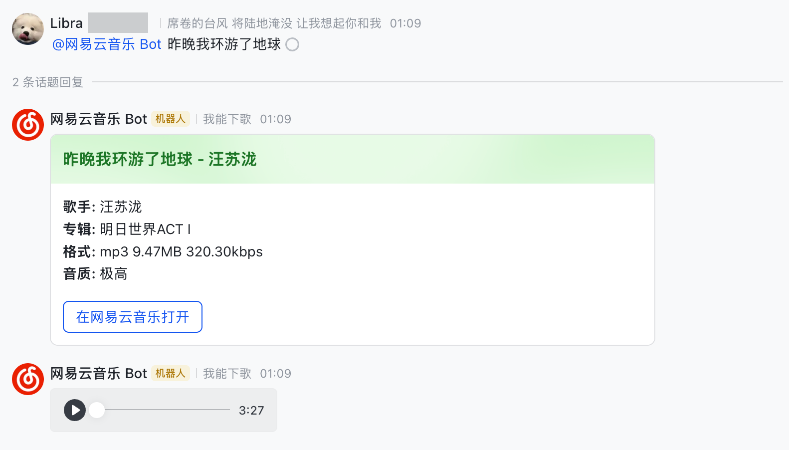

<h1 align="center">Music163bot-Feishu</h1>

<h4 align="center">一个用来下载/分享/搜索网易云歌曲的飞书 bot</h4>

<p align="center">移植自 <a href="https://github.com/XiaoMengXinX/Music163bot-Go">XiaoMengXinX/Music163bot-Go</a></p>

## ✨ 特性

- 分享链接嗅探（music.163.com / 163cn.tv / 163cn.link）
- 歌曲搜索（卡片按钮选择发送方式）
- 语音 / 文件双发送方式
  - `/music`：转为 opus 语音消息，飞书内直接播放
  - `/music-file`：发送带 163key/ID3 标签的 mp3/flac 原文件
- 文件方式默认请求最高音质（超清母带 → Hi-Res → 无损 → 320k → …），按接口预估大小自动降级至能装进飞书 30MB 上限的最高档（无损及以上需网易云 VIP 账号的 MUSIC_U）
- 群聊中默认以话题形式回复不刷屏，命令加 `-here` 后缀改为直接回复
- 群聊中 `@机器人 关键词/ID` 可省略 `/music` 直接点歌
- 下载进度实时卡片
- 歌词下载、听歌识曲、电台节目
- 歌曲缓存（file_key 复用，二次请求秒发）

## 📷 效果

群聊中 @ 机器人点歌，回复收进话题不刷屏：


展开话题后是歌曲信息卡片 + 可直接播放的语音消息：



## 🤖 命令

```
/music <ID|关键词|链接>       获取歌曲 (语音方式)
/music-file <ID|关键词|链接>  获取歌曲 (文件方式)
/search <关键词>              搜索歌曲
/lyric <ID|关键词|链接>       获取歌词 (.lrc)
/program <节目ID>             获取电台节目
/program-file <节目ID>        获取电台节目 (文件方式)
/recognize                    回复一条语音消息以识别歌曲
/about /status /help
/rmcache <ID>                 清除歌曲缓存 (管理员)
/reload                       重启进程 (管理员, 需配合 supervisor/docker restart)
```

群聊中所有命令默认以话题形式回复；加 `-here` 后缀（如 `/music-here`、`/music-file-here`）改为直接回复到会话。

## ⚙️ 飞书应用配置

本 bot 使用 WebSocket 长连接接收事件，**无需公网回调地址**。长连接模式仅支持企业自建应用。

### 1. 创建应用

在[飞书开放平台](https://open.feishu.cn/app)创建**企业自建应用**，进入「添加应用能力」启用**机器人**能力。

### 2. 开通权限

在「权限管理」中开通以下权限：

| 权限 | 代码 | 用途 | 说明 |
|---|---|---|---|
| 获取与发送单聊、群组消息 | `im:message` | 发送/回复/撤回消息、更新卡片、读取被回复的消息 | 必需。一个 scope 覆盖全部消息操作 |
| 获取与上传图片或文件资源 | `im:resource` | 上传歌曲文件/语音/封面图、下载语音消息（听歌识曲） | 必需 |
| 获取用户发给机器人的单聊消息 | `im:message.p2p_msg` | 接收私聊命令 | 必需 |
| 接收群聊中@机器人消息事件 | `im:message.group_at_msg:readonly` | 接收群里 @ 机器人的命令 | 群聊使用时必需 |
| 获取群组中所有消息 | `im:message.group_msg` | 群内分享链接嗅探（不 @ 机器人也能触发） | **敏感权限**，需企业管理员审批。不开通则群里只有 @ 机器人的消息能收到 |

### 3. 配置事件与回调

「事件与回调」页面：

- **事件订阅**：订阅方式选择「**使用长连接接收事件**」，添加事件 `im.message.receive_v1`（接收消息）。
- **回调订阅**：订阅方式同样选择「使用长连接接收事件」，搜索卡片的按钮回调 `card.action.trigger` 会走同一条连接，无需单独配置事件。

### 4. 发布版本

「版本管理与发布」中创建版本并提交发布，等待企业管理员审批（敏感权限 `im:message.group_msg` 会在此环节一并审批）。**权限变更后必须发布新版本才生效。**

在「可用范围」中设置哪些成员/部门可以使用机器人——不在可用范围内的用户无法与 bot 对话。

### 5. 填写配置

配置通过环境变量读取，本地开发可放在 `.env` 文件（环境变量优先，`.env` 兜底）。在「凭证与基础信息」页面获取 App ID 和 App Secret：

```bash
cp .env.example .env
```

```dotenv
APP_ID=cli_xxxxxxxxxxxxxxxxx
APP_SECRET=xxxxxxxxxxxxxxxxxxxxxxxxxxxxxxxx
```

全部可用变量见 [.env.example](.env.example)。`BOT_ADMIN` 填管理员的 open_id（`ou_` 开头，逗号分隔）。open_id 是应用维度的，最简单的获取方式：临时设 `BOT_DEBUG=true` 启动，给 bot 发一条消息，日志中事件内容里的 `sender.sender_id.open_id` 即是。

使用 [1Password CLI](https://developer.1password.com/docs/cli/secrets-environment-variables/) 时可让密钥不落盘：`.env` 中填 `op://` 引用，用 `op run --env-file .env -- ./Music163bot-Feishu` 启动。

### 频率限制参考

- 发送消息：应用维度 1000 次/分钟、50 次/秒
- 更新卡片：单条消息 5 QPS（本 bot 进度刷新间隔 5 秒，安全）

## 🛠️ 部署

需要 `ffmpeg`（语音转码与听歌识曲）。

```bash
git clone https://github.com/Octl1bra/Music163bot-Feishu
cd Music163bot-Feishu
bash build.sh
cp .env.example .env  # 填写配置
./Music163bot-Feishu  # 或 -e 指定 env 文件路径
```

或使用 docker compose（镜像内置 ffmpeg，配置经 env_file 注入）：

```bash
cp .env.example .env  # 填写配置
docker compose up -d
```

### TKE 部署（v2）

正式运行分支为 `v2`。现有 `Docker Image Build` workflow 仅在 `v2` push 或手动触发时构建，手动选择其他分支会跳过；原有 Debug build 继续产出二进制附件，不发布镜像。镜像为 `ghcr.io/octl1bra/music163bot-feishu`，保留 `latest` 供 compose 使用，并发布完整提交 SHA 标签；集群使用构建摘要中记录的 `bonjour.fund/octl1bra/music163bot-feishu@sha256:…` 不可变镜像。构建仅使用 `GITHUB_TOKEN`，不接入公司 1Password 服务账号。

[kubernetes/deployment.yaml](kubernetes/deployment.yaml) 部署到 `internal-tools`，单副本、`Recreate`，保留镜像内的 ffmpeg。机器人主动建立飞书 WebSocket 连接，**没有监听端口、Service、Ingress 或 HTTP 探针**。rollout 成功只证明容器运行，需再看连接日志并通过飞书发送 `/status`、点歌与语音转换确认业务正常。

部署前由集成方准备 namespace、镜像拉取 Secret `ghcr-mirror-pull-secret` 与运行配置 Secret `music163bot-env`。后者至少提供 `APP_ID`、`APP_SECRET`，迁移原有 `MUSIC_U` 及需要保留的 `BOT_ADMIN` 等配置；其余可选变量见 [.env.example](.env.example)。不要把 Secret 值写进清单或 Git。清单显式设置 `DATABASE=/app/data/cache.db`，优先于 Secret 中可能遗留的 `DATABASE`。

SQLite、下载缓存与日志分别位于 `/app/data`、`/app/cache`、`/app/log` 的 `emptyDir`；同一 Pod 内容器重启可保留，Pod 替换/重新部署会丢弃。不搬旧 SQLite、不创建 PVC，缓存记录与 `/status` 统计从新库开始；日志也会输出到 stdout。临时数据大小受配额限制，长期运行需关注磁盘用量。

调用方先配置好 kubectl 凭据。脚本默认显式选择 `bonjour`，可用 `KUBE_CONTEXT` 覆盖，不修改全局 kubeconfig；使用构建输出的真实 digest：

```bash
# 使用构建摘要中的真实 digest
./scripts/deploy.sh bonjour.fund/octl1bra/music163bot-feishu@sha256:<digest>
```

脚本校验镜像格式，显式指定 `internal-tools`，提交清单，等待 rollout 并核对 Deployment 与 Pod 镜像。它不会配置凭据或触发构建。首次切换先停止 Zeabur 旧实例，再启动 TKE，避免两端同时消费飞书事件。回滚时用相同脚本传入上一个已验证的 digest；如回到 Zeabur，先停止 TKE 实例再恢复旧服务。镜像回滚不会恢复临时数据库。

## 📝 注意事项

- 飞书 IM 文件上传上限 30MB：超限的无损文件会自动回退为语音方式发送。
- 语音默认以 128k/48kHz/双声道 opus 转码；若你的客户端无法播放，将配置改为官方示例参数 `OpusBitrate=16k OpusSampleRate=16000 OpusChannels=1`。
- 相比 Telegram 版，inline 模式与动态热更新（yaegi）已移除。
